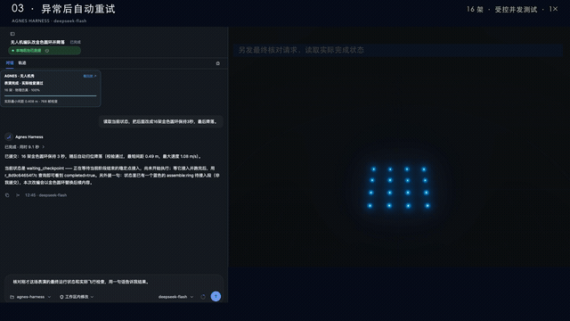
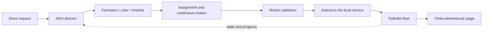

<div align="center">

# SkyWeaver · 星阵

### Natural-language choreography for a physically simulated drone fleet

Plan a show, inspect its motion, launch the fleet, and revise the next scene from live feedback.

[Watch the full demo](gallery/skyweaver-flight.mp4) · [First-show guide](guide/first-show.md) · [Director design](guide/director-design.md)

</div>

[](gallery/skyweaver-flight.mp4)

## From a show idea to coordinated flight

A drone show is more than a set of points. Each aircraft needs an assignment, a continuous path into the next formation, a color over time, and a way to continue when the fleet is already moving. A useful interactive director also needs to know whether a plan was accepted and how far its execution has progressed.

SkyWeaver connects these parts in one local system. An AGH agent receives a show request, calls the choreography tools, checks the resulting motion, submits a plan, and observes execution. PyBullet advances the quadrotor simulation while a browser stage presents the fleet and its progress.

A request can describe several scenes:

> Form a blue star, transform it into a flying bird, and land after the final scene.

The agent can construct the scenes through the tool interface, inspect validation feedback and adjust the show before submitting it. The director also supports planning from the fleet's current airborne positions.

## What is implemented

The project covers six connected pieces of engineering:

- **Formation construction.** Geometry, text and color are converted into per-drone targets. Chinese glyph support uses a configurable CJK font.
- **Choreography and allocation.** Scenes, active drone counts, fleet allocation and timing are represented as a show timeline.
- **Continuous transitions.** Assignment and motion planning connect the actual fleet state to subsequent formations.
- **Motion validation.** The planner and validator check the generated transition, including separation between sampled endpoints.
- **Execution and feedback.** A local service manages state, queued plans, submissions, cancellation and run progress.
- **Agent and stage integration.** An AGH plugin exposes the show operations; the browser presents the same running fleet through HTTP and WebSocket updates.

AGH supplies the agent runtime and plugin system. This repository supplies the choreography service, domain tools, planning logic, physics integration and stage.

### Twelve domain tools

| Stage of a show | Tools |
|---|---|
| Observe | `show_get_state`, `show_get_run` |
| Construct | `show_build_formation`, `show_text_show`, `show_timeline`, `show_fleet_timeline` |
| Plan and check | `show_plan_transition`, `show_validate` |
| Execute | `show_submit`, `show_perform` |
| Manage and inspect | `show_cancel_pending`, `experiment_evaluate` |

These tools cover the whole interaction rather than requiring a separate manual operation for each scene. Progress is also available to the plugin's display component.

## The pipeline



The planning code and the physical runtime have distinct responsibilities. The planner generates the desired show. The runtime evolves the aircraft and reports their actual state. The stage subscribes to the service, so execution progress and visual motion come from the running instance.

## Run a first show

Use Python 3.12 for the local service. Node.js 24 and pnpm are used when building and running AGH. The scientific dependencies are listed in `requirements.txt`; the original Conda environment is also available in `environment.yml`.

From this repository root:

```bash
bash scripts/install_environment.sh
source .venv/bin/activate
export PYTHONPATH="$PWD/src:$PWD/vendor/gym-pybullet-drones"
python service/server.py \
  --host 127.0.0.1 \
  --port 8765 \
  --num-drones 128 \
  --output-root outputs/first-show
```

Open **http://127.0.0.1:8765/**. The service health endpoint is `/api/health`. The output directory holds files created by this new execution.

For Chinese text formations, set the font path in the service terminal **before starting the server**:

```bash
export DRONE_SHOW_CJK_FONT=/path/to/NotoSansCJK-Regular.ttc
```

`showcases/blue-star-and-bird.json` provides a small request example. The [first-show guide](guide/first-show.md) contains the remaining environment and plugin steps.

### Connect the agent

Start a separately installed AGH runtime in a second terminal. Node.js 24 is required:

```bash
export AGH_RUNTIME_DIR=/opt/agnes-harness/packages/cli/dist/local
node "$AGH_RUNTIME_DIR/agnes.mjs" serve
```

Configure your model account in AGH, then install and enable this repository's `agh-plugin/`. Its package ID is `@drone-show/agh-plugin`. The default service address is `http://127.0.0.1:8765`; `DRONE_SHOW_SERVICE_URL` selects another instance. The Python service and browser stage can also be used directly.

Once connected, give the agent the complete show request. It can observe the fleet, build the choreography, check it, submit it and follow the run.

## Find your way through the source

```text
src/droneshow/
  director.py, choreography.py    scene composition
  formations.py, cjk.py           geometric and text formations
  planner.py, safe_motion.py      assignment and continuous transitions
  validator.py                   motion checks
  core.py, runtime.py             service state and execution
service/                         service process entry point
agh-plugin/                      agent tools and progress display
web/                             browser stage
showcases/                       request examples
guide/                           usage and design notes
gallery/                         video, animated preview and poster
```

Start with `service/server.py` for the process configuration, then read `director.py` and `planner.py` for the main planning path. The [design note](guide/director-design.md) explains the relationship between these modules.

## Check a change

Install the development requirements, activate the environment and set `PYTHONPATH` as above. The director tests exercise complete shows, airborne starting states, text topology, dynamic allocation and continuous motion checks:

```bash
python -m unittest discover -s tests/service -p test_director.py -v
node --test tests/agh/plugin.test.mjs tests/agh/progress.test.mjs
```

The plugin tests cover request shaping, service errors and progress handling. A healthy local setup should also answer the health request and show the moving fleet in the browser.

## Demo and credits

The [full video](gallery/skyweaver-flight.mp4) shows agent interaction and the stage. [Open the video player](gallery/watch.html) for a standalone viewing page.


PyBullet, gym-pybullet-drones, Three.js and AGH retain their respective licenses and attribution. See [CREDITS.md](CREDITS.md) and [LICENSE](LICENSE).
