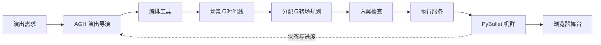

# 星阵 SkyWeaver

[English](README.md) | 简体中文

**一句演出需求，生成并执行一场协同仿真飞行。**

[](gallery/skyweaver-flight.mp4)

## 一、项目介绍

无人机演出不只是生成漂亮的队形：每架无人机要分配目标，场景之间需要连续转场，颜色要随时间变化，飞行中还要知道当前执行到了哪里。星阵把这些工作组织成一个交互式导演系统：AGH 接收自然语言需求，调用演出工具构建和检查方案，在 PyBullet 中执行，并在浏览器舞台展示机群状态。

例如输入“先组成蓝色星星，再变成飞鸟，最后降落”，系统可以组织场景和时间线；机群已经在空中时，也可以从当前飞行状态规划下一段动作。

- **队形构建**：生成几何图形、文字和逐机颜色；中文文字使用可配置的中文字体。
- **整场编排**：组合场景时长、参与数量、机群分配和转场。
- **规划与检查**：将目标分配给无人机，生成连续运动，并对转场进行验证。
- **执行与反馈**：服务维护状态、提交的方案和进度，舞台展示仿真机群的实际运动。

AGH 提供智能体运行时与插件机制；演出服务、领域工具、规划、物理仿真接入和舞台由本项目实现。

## 二、视频介绍

[观看完整无人机演出](gallery/skyweaver-flight.mp4)。上方动图可点击进入视频；[独立播放器](gallery/watch.html)适合在本地打开。视频展示从需求、编排到仿真舞台的过程。

可先查看[蓝色星星与飞鸟样例](showcases/blue-star-and-bird.json)，再按[首场演出指南](guide/first-show.md)运行新实例。

## 三、技术架构



| 层次 | 主要职责 | 入口 |
|---|---|---|
| 演出导演 | 组合队形、颜色和场景时间线 | `src/droneshow/director.py`、`choreography.py` |
| 运动规划 | 目标分配与连续转场 | `planner.py`、`safe_motion.py` |
| 执行服务 | 维护状态并执行提交的方案 | `core.py`、`runtime.py`、`service/server.py` |
| 智能体工具 | 注册领域工具，返回结构化反馈 | `agh-plugin/` |
| 三维舞台 | 显示机群运动与演出进度 | `web/` |

规划器负责生成预期运动；仿真运行时推进飞行并返回观测状态。[编排器设计说明](guide/director-design.md)进一步说明各模块的关系。

## 四、集成标准

### 工具与服务接口

原生插件包为 `@drone-show/agh-plugin`，共提供 12 个工具：状态观察（`show_get_state`、`show_get_run`）、队形与整场构建（`show_build_formation`、`show_text_show`、`show_timeline`、`show_fleet_timeline`）、规划与检查（`show_plan_transition`、`show_validate`）、执行（`show_submit`、`show_perform`）和管理（`show_cancel_pending`、`experiment_evaluate`）。

服务通过 `/api` 下的 HTTP JSON 接口交换数据，通过 `/ws` 推送舞台更新。例如 `show_build_formation` 接收 `num_drones` 和 `spec`，对应 `POST /api/formation`，返回队形标识和目标点；规划结果包含方案标识和检查信息，供后续提交。默认服务地址为 `http://127.0.0.1:8765`，可用 `DRONE_SHOW_SERVICE_URL` 指定其他实例。

### 启动服务并接入 AGH

服务使用 Python 3.12；单独安装的 AGH 运行时使用 Node.js 24：

```bash
bash scripts/install_environment.sh
source .venv/bin/activate
export PYTHONPATH="$PWD/src:$PWD/vendor/gym-pybullet-drones"
python service/server.py --host 127.0.0.1 --port 8765 --num-drones 128 --output-root outputs/first-show
```

浏览器打开 `http://127.0.0.1:8765/`，`/api/health` 用于健康检查。需要中文队形时，在启动前设置 `DRONE_SHOW_CJK_FONT`。在另一个终端启动 AGH：

```bash
export AGH_RUNTIME_DIR=/opt/agnes-harness/packages/cli/dist/local
node "$AGH_RUNTIME_DIR/agnes.mjs" serve
```

在 AGH 配置模型并安装启用 `agh-plugin/`。运行时由外部 AGH 安装提供，项目仓库提供演出插件与本地服务。

### 验证与许可

```bash
python -m unittest discover -s tests/service -p test_director.py -v
node --test tests/agh/plugin.test.mjs tests/agh/progress.test.mjs
```

这些检查覆盖演出组合、转场、插件请求和进度处理。组件来源与许可见 [CREDITS.md](CREDITS.md) 和 [LICENSE](LICENSE)。
