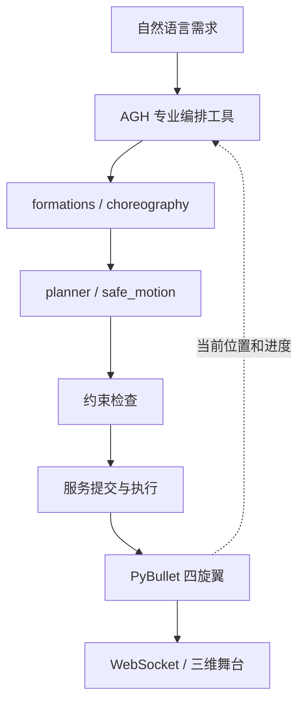

# 编排器与飞行舞台

一次演出先描述图案、颜色和顺序，再把这些场景转成连续运动。服务把规划结果、物理状态和舞台进度连接起来。

## 代码阅读顺序

1. `service/server.py`：服务配置、端口和机群规模。
2. `src/droneshow/director.py`：场景组合和整场演出生成。
3. `planner.py` 与 `safe_motion.py`：分配、转场和连续间距检查。
4. `agh-plugin/`：AGH 工具调用和进度呈现。
5. `web/`：舞台显示与交互。

`showcases/blue-star-and-bird.json` 保存一个需求样例。规划器计算新的运动方案，运行数据由服务在本机生成。
